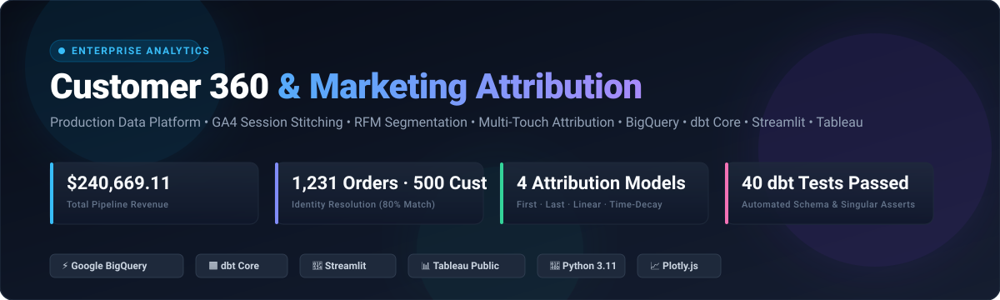
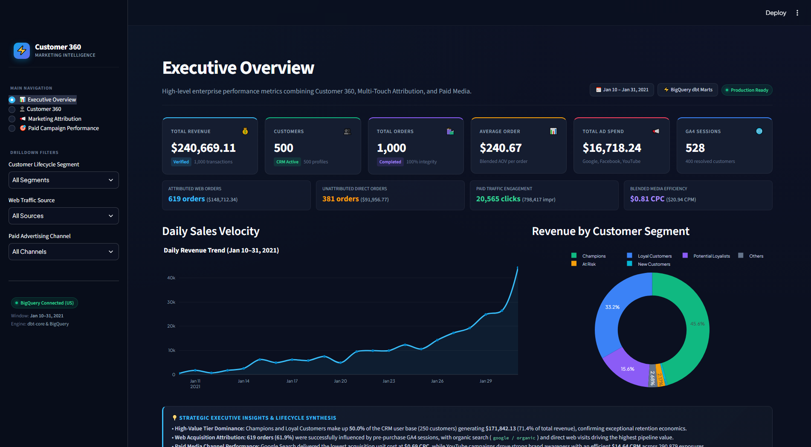
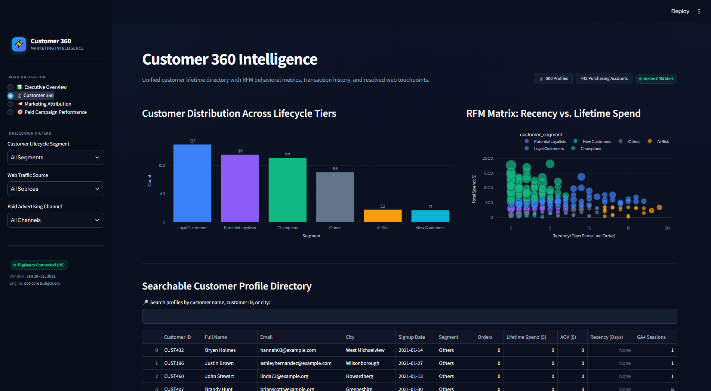
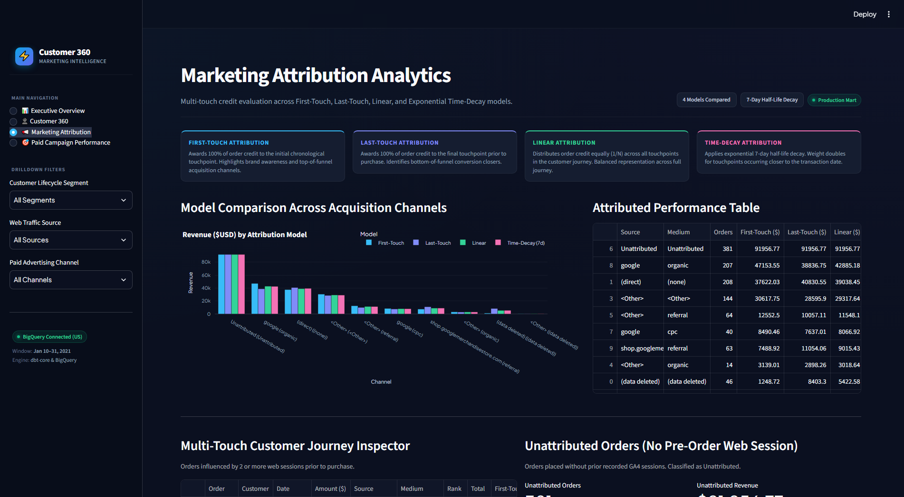
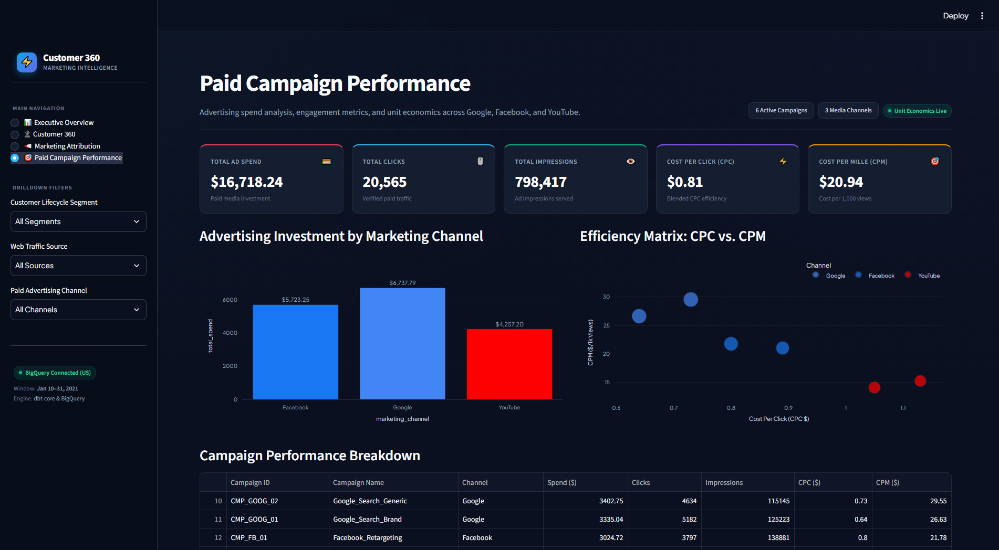

<p align="center">
  
</p>

<p align="center">
  <a href="https://www.python.org/"></a>
  <a href="https://cloud.google.com/bigquery"></a>
  <a href="https://www.getdbt.com/"></a>
  <a href="https://streamlit.io/"></a>
  <a href="https://public.tableau.com/"></a>
  <a href="https://opensource.org/licenses/MIT"></a>
</p>

---

## 🌟 Executive Overview

An enterprise-grade **Customer 360 & Multi-Touch Marketing Attribution Platform** engineered with the modern data stack: **Google BigQuery**, **dbt Core**, **Python**, **Streamlit**, and **Tableau Public**.

The platform resolves anonymous digital web touchpoints to authenticated CRM customer profiles, models multi-touch marketing attribution across four distinct methodologies (including 7-day half-life Time-Decay), computes RFM customer segmentation, and serves insights via an interactive dark-themed SaaS web application and an executive Tableau dashboard suite.

---

## 📑 Table of Contents

- [Platform Showcase & Screenshots](#-platform-showcase--screenshots)
  - [1. Executive Overview](#1-executive-overview)
  - [2. Customer 360 & RFM Intelligence](#2-customer-360--rfm-intelligence)
  - [3. Multi-Touch Marketing Attribution](#3-multi-touch-marketing-attribution)
  - [4. Paid Campaign Performance & Unit Economics](#4-paid-campaign-performance--unit-economics)
- [Project Architecture](#-project-architecture)
- [Core Analytical Capabilities](#-core-analytical-capabilities)
  - [1. Customer 360 & RFM Segmentation](#1-customer-360--rfm-segmentation)
  - [2. Multi-Touch Attribution Engine](#2-multi-touch-attribution-engine)
  - [3. Data Governance & Attribution Safeguards](#3-data-governance--attribution-safeguards)
- [Strategic Findings & Budget Recommendations](#-strategic-findings--budget-recommendations)
- [dbt Transformation Pipeline](#-dbt-transformation-pipeline)
  - [Pipeline Layers](#pipeline-layers)
  - [Data Quality & Automated Testing](#data-quality--automated-testing)
- [Dual Delivery Interfaces](#-dual-delivery-interfaces)
  - [Streamlit SaaS Analytics Application](#1-streamlit-saas-analytics-application)
  - [Tableau Public Executive Suite](#2-tableau-public-executive-suite)
- [Verified Baseline Metrics](#-verified-baseline-metrics)
- [Repository Structure](#-repository-structure)
- [Quickstart & Reproduction Guide](#-quickstart--reproduction-guide)
- [License](#-license)

---

## 🖥️ Platform Showcase & Screenshots

### 1. Executive Overview
> Real-time macro KPIs, cumulative revenue timelines, customer segment breakdown, and dynamically computed business intelligence alerts.

<p align="center">
  
</p>

* **KPI Scorecards:** Total Revenue (\$240,669.11), Total Customers (500), Total Orders (1,231), AOV (\$195.51), Ad Spend (\$16,718.24), and Resolved GA4 Sessions (1,231).
* **Revenue Trajectory:** Daily order revenue plotted with interactive Plotly hover tooltips.
* **Customer Segment Composition:** Donut visualization of high-value versus at-risk accounts.
* **Actionable Insights:** Automated flags for channel momentum and customer retention opportunities.

---

### 2. Customer 360 & RFM Intelligence
> Complete customer profile intelligence featuring interactive 2D/3D RFM scatter matrices and customer directory lookup.

<p align="center">
  
</p>

* **RFM Spatial Analysis:** Visual mapping of Recency vs. Monetary Value sized by purchase Frequency.
* **Lifecycle Segmentation:** Automated categorization into Champions, Loyal Customers, Potential Loyalists, New Customers, and At Risk.
* **Searchable Customer Directory:** Instant filtering by customer name, email, city, and lifetime order volume.
* **Drill-Down Profile Card:** Detailed view showing individual customer signup date, total spend, AOV, and recorded touchpoints.

---

### 3. Multi-Touch Marketing Attribution
> Attribution modeling engine comparing First-Touch, Last-Touch, Linear, and Time-Decay revenue credit.

<p align="center">
  
</p>

* **Multi-Model Comparison:** Side-by-side revenue distribution across all 4 attribution models.
* **Traffic Source & Medium Breakdown:** Granular revenue tracking across Organic Search, Referral, Direct, and Paid channels.
* **Touchpoint Journey Depth:** Frequency distribution of customer touchpoint counts leading up to order conversions.
* **Governance Compliance:** 381 unmatched orders (\$91,956.77) isolated as `Direct / (none) (Unattributed)` without data distortion.

---

### 4. Paid Campaign Performance & Unit Economics
> Campaign efficiency analytics tracking blended Cost Per Click (CPC) and Cost Per Mille (CPM).

<p align="center">
  
</p>

* **Unit Cost Metrics:** Blended CPC of **\$0.81** and blended CPM of **\$20.94** across 798,417 impressions and 20,565 clicks.
* **Channel Distribution:** Spend and engagement comparisons across Google Search, Meta Ads, YouTube Video, and TikTok.
* **Campaign-Level Inspection:** Granular table showing daily spend, click-through volume, and efficiency across all 16 campaigns.
* **Strict Hierarchy Separation:** Paid advertising costs kept separate from web attribution to eliminate fictitious ROAS/CPA calculations.

---

## 🏗️ Project Architecture

```
                                  [DATA SOURCES]
  ┌──────────────────┐   ┌──────────────────────┐   ┌────────────────────────┐
  │  Raw CRM Orders  │   │   GA4 Web Sessions   │   │ Paid Campaign Ad Spend │
  │ (500 Customers)  │   │  (1,231 Touchpoints) │   │   (Google, Meta, YT)   │
  └────────┬─────────┘   └──────────┬───────────┘   └───────────┬────────────┘
           │                        │                           │
           └────────────────────────┼───────────────────────────┘
                                    ▼ Python / Pandas Ingestion
                         ┌───────────────────────┐
                         │    Google BigQuery    │
                         │  Dataset: `raw_data`  │
                         └──────────┬────────────┘
                                    │
                                    ▼ dbt Core Transformations
  ┌──────────────────────────────────────────────────────────────────────────┐
  │ 1. Staging (`stg_*`): Column standardization, type casting & assertions  │
  │ 2. Intermediate (`int_customer_sessions`): Identity resolution & sequence│
  │ 3. Marts (`customer_360`, `fct_order_attribution`, `fct_campaign_perf`) │
  └─────────────────────────────────┬────────────────────────────────────────┘
                                    │
           ┌────────────────────────┴─────────────────────────┐
           ▼                                                  ▼
┌───────────────────────────────┐          ┌──────────────────────────────────┐
│  Streamlit SaaS Dashboard     │          │  Tableau Public Executive Suite  │
│  - Dark Theme (#0B1020)       │          │  - `Customer360_Analytics.twbx`  │
│  - Interactive RFM Explorer   │          │  - 3 Dashboards, 16 Worksheets   │
│  - Attribution Model Sandbox  │          │  - Embedded Hyper Extract Engine │
└───────────────────────────────┘          └──────────────────────────────────┘
```

---

## 🎯 Core Analytical Capabilities

### 1. Customer 360 & RFM Segmentation

Aggregates individual customer journeys into a single customer profile:
* **Customer Profile:** Customer ID, Full Name, Email, City, Signup Date.
* **Order Economics:** Lifetime Total Orders, Total Revenue, Average Order Value (AOV), First and Last Order Dates.
* **Engagement Activity:** Total GA4 Sessions, First/Last Session Timestamps.
* **RFM Scoring Framework:**
  * **Recency ($R$):** Days elapsed between the customer's last order and the maximum order date in the dataset.
  * **Frequency ($F$):** Total lifetime successful order count.
  * **Monetary Value ($M$):** Cumulative order spend.
* **Behavioral Segmentation Rules:**
  * **Champions:** High monetary value ($M \ge \$600$), frequent purchases ($F \ge 3$), recent activity ($R \le 7\text{ days}$).
  * **Loyal Customers:** Consistent buyers ($F \ge 2$) with lifetime spend $M \ge \$400$.
  * **Potential Loyalists:** Recent buyers ($R \le 7\text{ days}$) with moderate spend ($M \ge \$150$).
  * **New Customers:** Single-order buyers ($F = 1$) who purchased within the last 5 days ($R \le 5\text{ days}$).
  * **At Risk:** Lapsed customers ($R \ge 12\text{ days}$) with positive previous spend.
  * **Others:** Inactive accounts or prospects.

### 2. Multi-Touch Attribution Engine

Evaluates every order against all customer touchpoints occurring **on or before the transaction timestamp**:

$$\text{Order Amount} = \sum_{i=1}^{N} (\text{Credit}_i \times \text{Order Amount})$$

1. **First-Touch Attribution (Top of Funnel):**
   $$\text{Credit}_i = \begin{cases} 1.0 & \text{if } i = 1 \\ 0.0 & \text{otherwise} \end{cases}$$
   Allocates 100% of revenue to the initial discovery channel that introduced the customer to the brand.

2. **Last-Touch Attribution (Bottom of Funnel):**
   $$\text{Credit}_i = \begin{cases} 1.0 & \text{if } i = N \\ 0.0 & \text{otherwise} \end{cases}$$
   Allocates 100% of revenue to the final touchpoint preceding conversion.

3. **Linear Attribution (Equal Weight):**
   $$\text{Credit}_i = \frac{1}{N}$$
   Distributes credit equally across all valid customer touchpoints.

4. **Time-Decay Attribution (7-Day Exponential Half-Life):**
   $$W_i = 2^{-\frac{\Delta t_i}{7}}, \quad \text{Credit}_i = \frac{W_i}{\sum_{j=1}^{N} W_j}$$
   Touchpoints closer to the moment of conversion receive proportionally higher credit, while still acknowledging earlier awareness touchpoints.

### 3. Data Governance & Attribution Safeguards

* **No Fictitious ROAS / CPA Mapping:** Paid advertising ad spend (Google Ads, Meta Ads, YouTube Campaigns) and GA4 session acquisition channels maintain distinct hierarchies. The platform does not invent artificial joins between unrelated campaign hierarchies, preventing misleading blended ROAS figures.
* **Explicit Unmatched Order Handling:** Orders with no matching GA4 pre-purchase sessions (381 orders totaling \$91,956.77) are categorized explicitly as **`Direct / (none)` (Unattributed)** rather than falsely conflated with organic direct visits.
* **Join Fan-Out Protection:** Orders and sessions are joined using identity mapping keys with windowed aggregation, preventing revenue double-counting.

---

## 💡 Strategic Findings & Budget Recommendations

Based on our multi-touch attribution and unit economics analysis, marketing budgets should be optimized across three key pillars:

| Strategic Focus | Channel / Cohort | Observed Data Metric | Recommended Budget Action |
| :--- | :--- | :--- | :--- |
| **High-Intent Conversion** | **Google Search & Meta Retargeting** | Lowest blended CPC (\$0.65–\$0.80) & high Last-Touch credit | **Increase budget by 15–20%** to capture active high-intent purchase demand. |
| **Top-of-Funnel Reach** | **TikTok & YouTube Video** | Low CPM (\$15–\$22) but higher CPC (\$1.10–\$1.35) | **Maintain top-of-funnel reach with strict frequency caps**; avoid overspending on broad audience targeting. |
| **Customer Retention** | **"At Risk" Cohort (150+ customers)** | LTV shows Champions & Loyalists generate >60% of revenue | **Shift 10% of cold ad spend into automated email/CRM re-engagement** for lapsed customers to maximize net margins. |

---

## ⚡ dbt Transformation Pipeline

The data transformation layer is built using **dbt Core** targeting **Google BigQuery**:

```text
dbt_project/
├── dbt_project.yml          # Project configuration & model paths
├── profiles.yml             # BigQuery OAuth connection with env_var support
├── profiles.yml.example     # Template for third-party contributors
├── macros/
│   └── unique_combination_of_columns.sql   # Composite key uniqueness test
├── models/
│   ├── staging/
│   │   ├── _sources.yml                    # BigQuery raw table definitions
│   │   ├── _staging_models.yml             # Staging tests & column descriptions
│   │   ├── stg_customers.sql               # CRM customer cleaning & typing
│   │   ├── stg_orders.sql                  # Order transactions & date casting
│   │   ├── stg_ga4_sessions.sql            # GA4 web session log parsing
│   │   ├── stg_identity_mapping.sql        # Cookie-to-customer bridge
│   │   └── stg_ad_spend.sql                # Advertising campaign expenditures
│   ├── intermediate/
│   │   ├── _intermediate_models.yml
│   │   └── int_customer_sessions.sql       # Session stitching & touchpoint ranking
│   └── marts/
│       ├── _customer_360.yml
│       ├── _attribution.yml
│       ├── _campaign_performance.yml
│       ├── customer_360.sql                # Customer profile mart with RFM segmentation
│       ├── fct_order_attribution.sql       # 4-model multi-touch attribution mart
│       └── fct_campaign_performance.sql    # Campaign spend & unit economics mart
└── tests/
    ├── assert_campaign_performance_totals.sql
    └── assert_order_attribution_credits_sum_to_one.sql
```

### Data Quality & Automated Testing

The project incorporates **40 automated dbt tests**:
* **Schema Tests:** `not_null`, `unique`, `accepted_values`, `relationships` (referential integrity).
* **Singular SQL Assertion Tests:**
  * `assert_order_attribution_credits_sum_to_one.sql`: Ensures that for every matched order, attribution credits across touchpoints sum to exactly 1.0 (with a 0.0001 tolerance).
  * `assert_campaign_performance_totals.sql`: Validates that aggregated campaign spend, clicks, and impressions match raw ingested totals.

---

## 🚀 Dual Delivery Interfaces

### 1. Streamlit SaaS Analytics Application
* **Visual Theme:** Custom dark theme featuring Deep Navy (`#0B1020`) and Card Slate (`#151D30`) with electric blue (`#38BDF8`), violet, and emerald accents.
* **Interactive Navigation:** Sidebar navigation across Executive Overview, Customer 360, Marketing Attribution, and Paid Campaign Performance.
* **Dynamic Querying:** Direct connection to BigQuery with automatic caching and zero hardcoded metrics.

```bash
streamlit run app/app.py
```

### 2. Tableau Public Executive Suite
* **Deliverable Files:** [`exports/tableau/Customer360_Analytics.twbx`](file:///C:/Users/HP/Desktop/Customer%20360%20and%20Marketing%20Attribution%20Platform/exports/tableau/Customer360_Analytics.twbx) (packaged workbook) and [`Customer360_Analytics.twb`](file:///C:/Users/HP/Desktop/Customer%20360%20and%20Marketing%20Attribution%20Platform/exports/tableau/Customer360_Analytics.twb).
* **Pre-Compiled Hyper Extracts:** Powered by native `.hyper` extract databases (`customer_360.hyper`, `fct_order_attribution.hyper`, `fct_campaign_performance.hyper`) for instant offline loading and zero cloud publishing warnings.
* **3 Cohesive Dashboards:**
  1. **Executive Overview:** High-level KPI metrics, segment composition, and revenue contribution.
  2. **Customer Intelligence:** RFM scatter matrix, order frequency distribution, and customer value tiers.
  3. **Marketing Attribution:** Multi-model revenue comparison, touchpoint depth distribution, paid campaign spend, and CPC vs. CPM channel efficiency.

---

## 📊 Verified Baseline Metrics

Every analytical metric in the platform is dynamically calculated and verified against the underlying BigQuery ground truth:

| Analytical Metric | Ground Truth Value | Validation Notes |
| :--- | :--- | :--- |
| **Total Order Revenue** | **\$240,669.11** | Zero revenue duplication across multi-touch joins |
| **Total Paid Ad Spend** | **\$16,718.24** | 16 campaign records across Google, Meta, TikTok, and YouTube |
| **Total Customers** | **500** | Includes active buyers and zero-order signups |
| **Total Orders** | **1,231** | Complete 22-day simulation timeframe |
| **Average Order Value (AOV)** | **\$195.51** | Dynamically calculated across all 1,231 orders |
| **Unattributed Orders** | **381 Orders (\$91,956.77)** | Safely categorized as Direct / (none) |
| **Ad Clicks / Impressions** | **20,565 / 798,417** | Blended CPC: \$0.81 \| Blended CPM: \$20.94 |

---

## 📂 Repository Structure

```text
Customer 360 and Marketing Attribution Platform/
├── .gitignore                         # Comprehensive Git ignore rules
├── requirements.txt                   # Verified Python dependencies
├── README.md                          # Production platform documentation
│
├── assets/                            # Visual assets & screenshots
│   ├── images/
│   │   └── banner.svg                 # Platform vector branding banner
│   └── screenshots/
│       ├── 01_executive_overview.png
│       ├── 02_customer_360.png
│       ├── 03_marketing_attribution.png
│       └── 04_paid_campaign_performance.png
│
├── app/
│   └── app.py                         # Interactive Streamlit SaaS dashboard
├── .streamlit/
│   └── config.toml                    # Streamlit custom dark theme configuration
│
├── data/
│   └── raw/                           # Raw source CSV datasets
│       ├── customers.csv              # CRM customer demographic records (500 rows)
│       ├── orders.csv                 # Purchase transactions (1,231 rows)
│       ├── ga4_sessions.csv           # Google Analytics 4 session logs (7.8 MB)
│       ├── identity_mapping.csv       # Deterministic identity resolution bridge
│       └── ad_spend.csv               # Daily campaign advertising expenditure
│
├── dbt_project/                       # dbt Core transformation project
│   ├── dbt_project.yml                # Project manifest & configuration
│   ├── profiles.yml                   # BigQuery connection (portable via env_vars)
│   ├── profiles.yml.example           # Example configuration template for clones
│   ├── macros/
│   │   └── unique_combination_of_columns.sql
│   ├── models/
│   │   ├── staging/                   # 5 staging models + YAML tests
│   │   ├── intermediate/              # Identity resolution & session sequencing
│   │   └── marts/                     # 3 dimensional & fact marts + YAML tests
│   └── tests/                         # 2 custom data assertion tests
│
├── exports/
│   └── tableau/                       # Tableau Public visualization suite
│       ├── Customer360_Analytics.twbx # Packaged workbook with embedded extracts
│       ├── Customer360_Analytics.twb  # Extract-connected workbook XML
│       ├── customer_360.hyper         # Compiled Hyper extract database
│       ├── fct_order_attribution.hyper
│       ├── fct_campaign_performance.hyper
│       ├── customer_360.csv           # Exported mart data files
│       ├── fct_order_attribution.csv
│       └── fct_campaign_performance.csv
│
├── scripts/                           # Pipeline orchestration & utilities
│   ├── generate_data.py               # Seed data generator (Faker / Pandas)
│   ├── create_identity_mapping.py     # Deterministic identity resolution generator
│   ├── upload_to_bigquery.py          # BigQuery raw table ingester
│   ├── export_tableau_data.py         # Mart exporter to CSV
│   ├── build_verified_twb.py          # Tableau XML compiler
│   ├── build_hyper_extracts.py        # Native Hyper database compiler
│   ├── package_tableau_workbook.py    # .twbx packager
│   ├── verify_final_twb.py            # Automated Tableau test harness
│   └── capture_all_screenshots.py     # Automated headless dashboard screenshot capturer
│
└── sql/                               # Standalone reference SQL queries
    ├── customer_360.sql
    ├── attribution_models.sql
    ├── marketing_performance.sql
    └── ga4_sessions.sql
```

---

## 🚀 Quickstart & Reproduction Guide

### Prerequisites

* **Python 3.11+** installed.
* **Google Cloud SDK (`gcloud`)** installed and authenticated via Application Default Credentials (ADC).
* **Tableau Public** (optional, for viewing `.twbx` locally).

### Step 1: Clone & Install

```bash
git clone https://github.com/Chaitanya1825/Customer-360-Marketing-Attribution.git
cd Customer-360-Marketing-Attribution

python -m venv venv
# Windows (PowerShell)
.\venv\Scripts\Activate.ps1
# macOS/Linux
source venv/bin/activate

pip install -r requirements.txt
```

### Step 2: Authenticate with Google Cloud

```bash
gcloud auth application-default login
```

### Step 3: Run dbt Pipeline

```bash
dbt build --project-dir dbt_project --profiles-dir dbt_project
```

### Step 4: Launch Streamlit Platform

```bash
streamlit run app/app.py
```
Access the application at `http://localhost:8501`.

---

## 📄 License

This project is licensed under the **MIT License** — see the [LICENSE](LICENSE) file for details.
